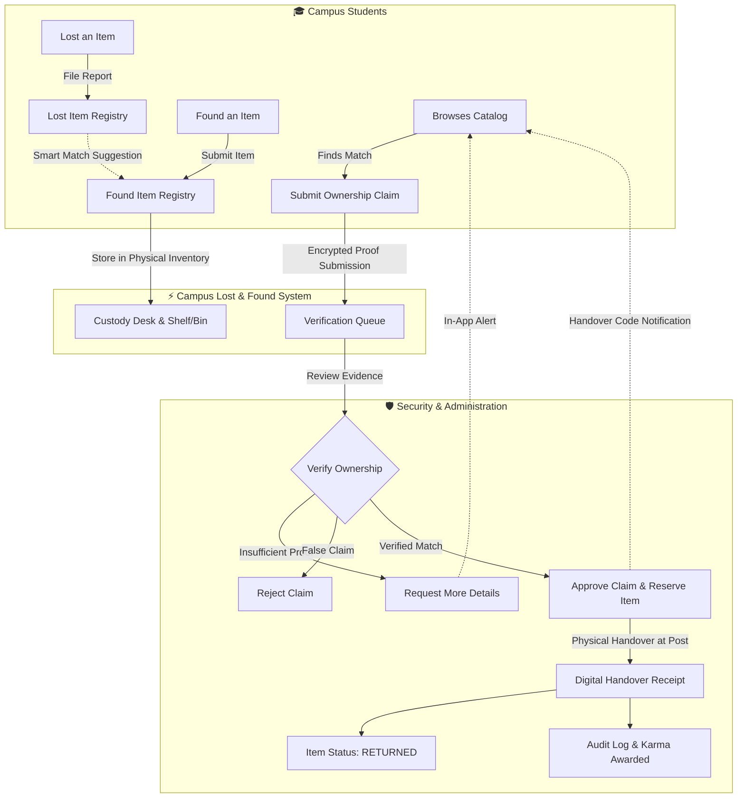

# 🎓 Campus Lost & Found – P04

<p align="center">
  
  
  
  
  
  
</p>

<h3 align="center">
  A Full-Stack, Role-Based Lost &amp; Found Management System for a 600-Acre University Campus
</h3>

<p align="center">
  Developed as an academic capstone group project at <strong>Lovely Professional University (LPU)</strong> to digitalize and streamline lost property retrieval, ownership verification, security custody management, and handover workflows.
</p>

<p align="center">
  🚀 <strong><a href="https://lost-and-found-campus-iota.vercel.app/">View Live Application</a></strong> &nbsp;•&nbsp; 
  💻 <strong><a href="https://github.com/Sparsh88/lost-and-found-campus">GitHub Repository</a></strong> &nbsp;•&nbsp;
  📊 <strong><a href="./campus-workflow-diagram.svg">System Workflow SVG</a></strong>
</p>

---

## 📌 Table of Contents

- [Executive Summary](#-executive-summary)
- [Key Features](#-key-features)
- [System Architecture & Workflow](#-system-architecture--workflow)
- [Tech Stack](#-tech-stack)
- [Live Demo & Test Accounts](#-live-demo--test-accounts)
- [Project Directory Structure](#-project-directory-structure)
- [Database Schema & Models](#-database-schema--models)
- [REST API Reference](#-rest-api-reference)
- [Getting Started & Local Setup](#-getting-started--local-setup)
- [Environment Variables](#-environment-variables)
- [Security & Engineering Practices](#-security--engineering-practices)
- [Team Collaboration & Module Ownership](#-team-collaboration--module-ownership)
- [License & Academic Declaration](#-license--academic-declaration)

---

## 💡 Executive Summary

### The Problem
On a massive **600-acre campus** with over 30,000+ students, faculty members, and campus visitors, hundreds of essential personal belongings—such as student identity cards, laptops, smartphones, lab records, wallets, and room keys—are misplaced daily. Traditional recovery relies on fragmented WhatsApp broadcast groups, unofficial social media pages, or uncoordinated physical lost-and-found security counters. This leads to:
1. Low recovery rates and prolonged delays in returning essential items.
2. High susceptibility to fraudulent claims due to lack of ownership verification.
3. Zero centralized accountability for security desks holding found property.
4. Privacy risks associated with students sharing personal phone numbers publicly online.

### The Solution
**Campus Lost & Found (P04)** is a full-stack, end-to-end web application that connects students, good samaritans, and campus security authorities into a single verified network. It features:
- **Centralized Item Catalogs:** Real-time searchable directories for lost and found property.
- **Strict Verification Claim Engine:** Fraud-resistant multi-step verification before item release.
- **Custody & Handover Tracking:** Specific shelf/bin physical storage logging with digital handover receipts.
- **Role-Based Access Control:** Distinct workspaces for Students, Campus Security Officers, and Chief Administrators.
- **In-App Notifications & Community Karma:** Real-time status updates and incentives rewarding honest students.

---

## ✨ Key Features

### 🎓 1. Student Portal
- **Report Lost Belongings:** Submit detailed incident reports with category, brand, distinctive identifiers (stickers, serial numbers, wallpapers), last seen campus zone, date, and photos.
- **Public Found Items Catalog:** Browse items recovered across campus with category pills, campus zone filters, and keyword search.
- **Direct Found Item Submission:** Log an item you stumbled upon, choose whether to keep custody until claimed or turn it in to the nearest Campus Security Desk.
- **"My Reports" Dashboard:** Personal command center tracking all reported lost items, found submissions, active claims, and earned community **Karma Points**.
- **Real-Time In-App Notifications:** Automatic alerts whenever a claim status changes (Approved, Additional Info Requested, Handover Ready).

### 🛡️ 2. Verification & Anti-Fraud Claim Engine
- **Ownership Verification Questions:** Claimants must supply verifiable proof of ownership (e.g. device password/wallpaper description, matching registration numbers, hidden marks) before contact or handover details are unlocked.
- **Private File Attachments:** Claimant can upload bills, purchase invoices, or secondary identification securely.
- **Multi-State Claim Lifecycle:** Tracks states through `PENDING` ➔ `ADDITIONAL_INFO_REQUESTED` ➔ `APPROVED` / `REJECTED` ➔ `COMPLETED`.

### 🏢 3. Campus Security & Custody Management
- **Physical Inventory Binning:** Records the precise custody station (e.g., *Main Security Office*, *Engineering Block A Desk*, *Gate 1*) and internal bin/shelf IDs (e.g., `Shelf B-12`).
- **Official Handover Digital Receipts:** Formalizes the item return with claimant ID verification, security officer badge recording, and digital timestamping.
- **Item Reservation Status:** Prevents duplicate handovers by switching items from `AVAILABLE` to `RESERVED_FOR_HANDOVER` during active claims.

### 📊 4. Admin Control Center & Audit Trails
- **System Overview Analytics:** Real-time metrics on total reports, active lost items, items in custody, and completed returns.
- **Tamper-Evident Audit Logs:** Automatically logs critical actions (claim reviews, item status changes, inventory updates, user blocking).
- **User Management:** Ability to block abusive accounts and manage administrative access.

---

## 🏗️ System Architecture & Workflow



> 💡 *An interactive vector diagram viewer is included in the project at [`workflow-diagram.html`](./workflow-diagram.html) and [`campus-workflow-diagram.svg`](./campus-workflow-diagram.svg).*

---

## 🛠 Tech Stack

| Layer | Technologies Used | Description |
|---|---|---|
| **Frontend Framework** | **Next.js 14** (App Router) | Server-Side Rendering (SSR), Server Components, dynamic routing |
| **User Interface** | **React 18** + **Tailwind CSS** | Accessible, responsive, mobile-optimized UI styled with utility classes |
| **Icons & Feedback** | **Lucide React** + **Sonner** | Modern iconography and lightweight stacked toast notifications |
| **Backend & APIs** | **Next.js API Routes** | RESTful Node.js endpoints with runtime schema validation |
| **Database & ODM** | **MongoDB Atlas** + **Mongoose** | Managed cloud NoSQL database with strict schema models and indexing |
| **Authentication** | **JWT (`jose`)** + **`bcryptjs`** | Secure HTTP-only cookies, salted password hashing, and role guard middleware |
| **Validation & Security** | **Zod** + **Rate Limiting** | Strict request body validation and API rate limiting against abuse |
| **Deployment & Hosting** | **Vercel** | Global edge network with automatic CI/CD deployment from GitHub |

---

## 🚀 Live Demo & Test Accounts

You can test the production application right away without manual setup:

🌐 **Live URL:** [https://lost-and-found-campus-iota.vercel.app/](https://lost-and-found-campus-iota.vercel.app/)

The database includes pre-seeded accounts to demonstrate role-based permissions:

| Role | Email Address | Password | Permissions & Scope |
|---|---|---|---|
| **Chief Administrator** | `admin@campus.edu` | `Admin@123` | Full dashboard, audit logs, user management, global oversight |
| **Campus Security Officer** | `security@campus.edu` | `Security@123` | Custody desk logging, claim approvals, handover receipt generation |
| **Student** | `rahul.sharma@campus.edu` | `Student@123` | Report lost/found items, file claims, view personal reports & karma |
| **Student (Alternate)** | `priya.patel@campus.edu` | `Student@123` | Secondary student account for simulating peer interactions |

---

## 📁 Project Directory Structure

```text
lost-and-found-campus/
├── public/                       # Static public assets (campus images, logos)
├── scripts/
│   └── seed.js                   # Automated MongoDB Atlas seeder with demo dataset
├── src/
│   ├── app/                      # Next.js 14 App Router hierarchy
│   │   ├── admin/                # Admin & Security management portals
│   │   │   ├── dashboard/        # Operational overview, claims queue, audit logs
│   │   │   └── login/            # Elevated staff login page
│   │   ├── api/                  # RESTful API Route handlers
│   │   │   ├── admin/            # Protected admin endpoints (claims, audit, handovers)
│   │   │   ├── auth/             # Login, registration, token verification, session
│   │   │   ├── claims/           # Claim filing, status updates, evidence review
│   │   │   ├── found-items/      # Found item registration, search & filters
│   │   │   ├── lost-items/       # Lost item reporting & listing
│   │   │   ├── notifications/    # User in-app notifications
│   │   │   └── uploads/          # Image and attachment handlers
│   │   ├── claims/               # Public claim verification pages
│   │   ├── dashboard/            # Student analytics & general overview
│   │   ├── found/                # Found items directory, details, & report form
│   │   ├── lost/                 # Lost items directory, details, & report form
│   │   ├── my-reports/           # Personalized student submissions & claims
│   │   ├── notifications/        # User notification inbox
│   │   ├── globals.css           # Global Tailwind stylesheet
│   │   ├── layout.js             # Root application shell (Navbar, Footer, Providers)
│   │   └── page.js               # Landing page with hero, stats, and recent items
│   ├── components/               # Reusable UI component library
│   │   ├── ui/                   # Modular atoms (badges, cards, buttons)
│   │   ├── Navbar.jsx            # Dynamic navigation bar with auth & notification status
│   │   ├── Footer.jsx            # University footer & quick navigation
│   │   └── FinderModal.jsx       # Direct contact / claim modal dialog
│   ├── lib/                      # Shared server utilities & configurations
│   │   ├── auth.js               # JWT sign/verify helpers & session cookie extraction
│   │   ├── constants.js          # Campus zones, categories, and item statuses
│   │   ├── mongodb.js            # Cached Mongoose connection instance
│   │   ├── notifications.js      # System notification dispatcher
│   │   └── validators.js         # Zod data schemas
│   ├── models/                   # Mongoose Object Data Models
│   │   ├── AuditLog.js           # Security action auditing
│   │   ├── Claim.js              # Verification claims & evidence
│   │   ├── FoundItem.js          # Found items & custody metadata
│   │   ├── Handover.js           # Physical item release records
│   │   ├── LostItem.js           # Lost item incident reports
│   │   ├── Notification.js       # User notification documents
│   │   └── User.js               # Campus accounts (Students, Security, Admin)
│   └── modules/                  # Modular domain logic
├── campus-workflow-diagram.svg   # Vector operational architecture diagram
├── workflow-diagram.html         # Standalone diagram viewer
├── package.json                  # NPM project manifest & dependencies
└── tailwind.config.js            # Custom design tokens & theme configuration
```

---

## 🗄️ Database Schema & Models

The system is built on **8 strongly-typed Mongoose models**:

| Model | Collection | Primary Responsibility |
|---|---|---|
| **`User`** | `users` | Stores student/staff profile, registration number, bcrypt password hash, role (`student`, `security`, `admin`), and karma score. |
| **`LostItem`** | `lostitems` | Records details of misplaced property: `reportId`, name, category, campus location, date/time, description, image, and status (`ACTIVE`, `CLOSED`, `RETURNED`). |
| **`FoundItem`** | `founditems` | Tracks discovered belongings: `foundId`, custody office, shelf/bin ID, finder details, contact disclosure preference, and status (`AVAILABLE`, `RESERVED_FOR_HANDOVER`, `RETURNED`, `CLOSED`). |
| **`Claim`** | `claims` | Stores verification claims: `claimId`, foreign key references to `FoundItem` and claimant `User`, unique identifiers, proof answers, and review status. |
| **`Handover`** | `handovers` | Official transfer receipt documenting handover officer ID, recipient registration number, verification notes, and exact timestamp. |
| **`Notification`** | `notifications` | In-app alerts informing users when their claim progresses, evidence is requested, or matches are discovered. |
| **`AuditLog`** | `auditlogs` | Immutable audit trail of administrative events for institutional accountability. |
| **`FinderSubmission`** | `findersubmissions`| Light-weight peer inquiry records submitted by campus finders. |

---

## 🔌 REST API Reference

The project provides structured REST API endpoints organized under Next.js App Router:

### Authentication & Profiles
- `POST /api/auth/register` — Register a student account with institutional ID.
- `POST /api/auth/login` — Authenticate user and issue secure HTTP-only JWT cookie.
- `POST /api/auth/logout` — Invalidate user session.
- `GET  /api/auth/me` — Retrieve active user session and role profile.

### Item Management
- `GET  /api/lost-items` — List and filter lost items (category, campus location, date, keyword).
- `POST /api/lost-items` — Create a new lost item incident report.
- `GET  /api/lost-items/:id` — Retrieve specific lost item report details.
- `GET  /api/found-items` — Browse found items available across campus.
- `POST /api/found-items` — Register a found item and record custody info.
- `GET  /api/found-items/:id` — Detailed found item record (with conditional finder contact privacy).

### Claims & Verification
- `POST /api/claims` — Submit an ownership claim with distinctive proof.
- `GET  /api/claims/:id` — Fetch status of a filed claim.
- `PATCH /api/admin/claims/:id` — Security officer reviews, approves, or requests more information on a claim.

### Security Desk & Administration
- `GET  /api/admin/overview` — Aggregated operational statistics and recovery rates.
- `POST /api/admin/handovers` — Record formal item handover and release to student.
- `GET  /api/admin/audit-logs` — Retrieve compliance audit trails.

---

## 💻 Getting Started & Local Setup

### Prerequisites
- **Node.js**: `v18.17.0` or higher
- **npm**: `v9.0.0` or higher
- **MongoDB**: A free cloud instance on [MongoDB Atlas](https://www.mongodb.com/atlas) or a local MongoDB server (`mongodb://localhost:27017`)

### 1. Clone Repository
```bash
git clone https://github.com/Sparsh88/lost-and-found-campus.git
cd lost-and-found-campus
```

### 2. Install Dependencies
```bash
npm install
```

### 3. Configure Environment Variables
Create a `.env.local` file in the root directory:
```bash
cp .env.example .env.local
```
Fill in your configuration values:
```env
# MongoDB Connection String
MONGODB_URI=mongodb+srv://<username>:<password>@cluster.mongodb.net/campus-lost-and-found?retryWrites=true&w=majority

# JWT Secret for Session Security
JWT_SECRET=your_super_secret_jwt_key_at_least_32_characters_long

# Base Application URL
NEXT_PUBLIC_APP_URL=http://localhost:3000

# Cloudinary (Optional - for direct cloud image uploads)
CLOUDINARY_CLOUD_NAME=your_cloud_name
CLOUDINARY_API_KEY=your_api_key
CLOUDINARY_API_SECRET=your_api_secret
```

### 4. Seed the Database
Populate the database with sample campus locations, initial categories, test accounts, lost reports, and found custody entries:
```bash
npm run seed
```

### 5. Launch the Development Server
```bash
npm run dev
```

Visit [http://localhost:3000](http://localhost:3000) in your web browser.

---

## ⚙️ Environment Variables

| Variable | Required | Default | Description |
|---|---|---|---|
| `MONGODB_URI` | **Yes** | — | MongoDB Atlas or local connection URI. |
| `JWT_SECRET` | **Yes** | — | Secret string utilized by `jose` to sign session cookies. |
| `NEXT_PUBLIC_APP_URL` | No | `http://localhost:3000` | Canonical origin URL for client redirects and links. |
| `CLOUDINARY_CLOUD_NAME` | No | — | Cloudinary cloud identifier for external image hosting. |
| `CLOUDINARY_API_KEY` | No | — | Cloudinary API Key. |
| `CLOUDINARY_API_SECRET` | No | — | Cloudinary API Secret. |

---

## 🔒 Security & Engineering Practices

1. **Authentication & Session Safety:**
   - Stateless JWT tokens signed via `jose` and delivered via `HttpOnly`, `SameSite=Lax`, `Secure` cookies to defend against XSS and token exfiltration.
2. **Password Cryptography:**
   - Passwords hashed using `bcryptjs` with 12 salt rounds before persisting to MongoDB.
3. **Privacy by Design:**
   - Finder contact numbers and sensitive claimant answers are never exposed to public listing APIs. Contact details are only unlocked after verified security approval.
4. **Input Sanitization & Schema Validation:**
   - All inbound payloads are validated using `Zod` schemas to prevent payload injection and schema corruption.
5. **Rate Limiting:**
   - In-memory rate limiting shields authentication and reporting endpoints against automated spam.
6. **Optimized Image Handling:**
   - Next.js dynamic image fallbacks resolve category-specific assets if custom photographs are omitted.

---

## 👥 Team Collaboration & Module Ownership

This system was structured and engineered as a collaborative group capstone project (**Project Code: P04**):

| Module | Service Scope | Primary Responsibilities |
|---|---|---|
| **Module 1** | **Lost Item Service** | Lost item reporting portal, category categorization, date/zone filtering, and public lost directory. |
| **Module 2** | **Found Item Service** | Found item registration, campus custody assignment, inventory search, and shelf/bin indexer. |
| **Module 3** | **Claim & Verification Service** | Anti-fraud verification engine, security evidence review, handover receipts, and audit trail. |

### Git Workflow Followed
- **Feature Branching:** Teammates worked on isolated branches (`module-1-lost`, `module-2-found`, `module-3-claims`).
- **Code Review:** Pull Requests reviewed and verified before squash-merging into `main`.
- **Automated Deployments:** Every push to `main` triggered automatic verification and edge deployment on Vercel.

---

## 📄 License & Academic Declaration

This repository is developed for educational purposes as part of the academic curriculum at **Lovely Professional University (LPU)**.

- **License:** Open for academic, non-commercial, and educational demonstration purposes under the [MIT License](https://opensource.org/licenses/MIT).
- **Authors:** Project Group P04
- **Live Deployment:** [lost-and-found-campus-iota.vercel.app](https://lost-and-found-campus-iota.vercel.app/)
- **Source Code:** [github.com/Sparsh88/lost-and-found-campus](https://github.com/Sparsh88/lost-and-found-campus)
