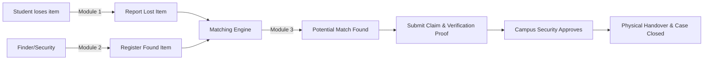

# 📍 Campus Lost & Found Management System

> **Problem Statement (P04):** Lost IDs, laptops, bottles, and documents on a 600-acre campus frequently fail to reach their owners because there is no trusted and visible recovery channel connecting finders, owners, and campus authorities.

---

## 👥 Module Breakdown & Team Responsibilities

| Module | Service Name | Responsibilities | Assigned To |
|---|---|---|---|
| **Module 1** | **Lost Item Service** | • Student authentication & lost item reporting form • Search & filter existing reported items • Real-time alerts/notifications when matches occur | TBD |
| **Module 2** | **Found Item Service** | • Finder / Campus Security item logging • Storage location & handover desk tagging • QR code / reference ID generation for physical tag | TBD |
| **Module 3** | **Claim & Verification Service** | • Automated matching engine (Lost ↔ Found) • Ownership verification (proof, secret question, ID check) • Handover confirmation & status audit log | TBD |

---

## 🔄 End-to-End Workflow & Integration

---

## 🛠️ Team Git Guidelines (Avoiding Merge Conflicts)

1. **Never commit directly to `main`**:
   - `main` branch is reserved for stable, working releases.
2. **Feature Branch Naming Convention**:
   - Module 1: `feature/module-1-lost-service`
   - Module 2: `feature/module-2-found-service`
   - Module 3: `feature/module-3-claim-service`
3. **Pull Request (PR) Workflow**:
   - Pull latest main before pushing: `git checkout main && git pull origin main`
   - Push your branch: `git push origin <your-branch-name>`
   - Create a Pull Request on GitHub and have at least one teammate review it.
